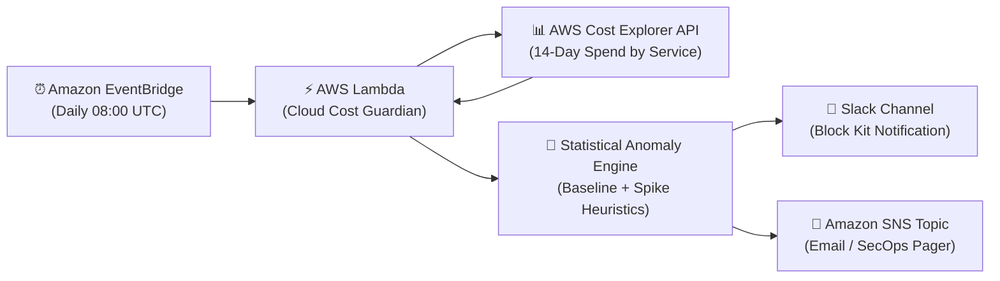

# Cloud Cost Guardian 🛡️💰

> **FinOps Automated Cost-Anomaly Detection Engine** — Daily rolling baseline analysis on AWS spend with Slack Block Kit alerts, SNS event notifications, and actionable root cause diagnostics.

[](https://github.com/TarunKumarPardeshi/cloud-cost-guardian/actions/workflows/deploy.yml)
[](https://www.python.org/downloads/release/python-3120/)
[](https://www.terraform.io/)
[](https://aws.amazon.com/)

---

## 📖 Overview

**Cloud Cost Guardian** is an enterprise-grade serverless FinOps tool that monitors daily AWS cloud expenditures across all active services. It computes a 14-day dynamic rolling baseline and detects statistically anomalous cost surges (e.g., untagged compute instances, rogue GPU jobs, unbounded S3 replication, or runaway NAT gateway cross-AZ traffic).

When a spike crosses your defined threshold ($\ge 20\%$ and $\ge \$10$ surge by default), it dispatches rich Slack notifications containing:
- 📈 Total daily spend vs. 14-day rolling baseline
- 🔍 Service-by-service anomaly drilldown (current cost, delta amount, percentage surge)
- 💡 Domain-specific root-cause remediation guidance (e.g. unattached EBS volumes, snapshot retention)
- ⚡ Interactive action buttons linking directly into AWS Cost Explorer & CloudTrail

---

## 🏗️ Architecture



---

## 📱 Sample Slack Alert

```
🚨 AWS Cost Spike Alert | Cloud Cost Guardian
Target Date: 2026-10-09
Spend: $435.30 | 14-Day Baseline: $310.00 | Variance: +$125.30 (+40.4%)
─────────────────────────────────────────────────────────────
⚠️ Detected Service Anomalies:

Service: Amazon Elastic Compute Cloud - Compute
Daily Spend: $245.80 (Baseline: $120.00)
Spike: +104.8% (+$125.80)
Action Hint: Check for newly launched unreserved on-demand instances or unattached EBS volumes.

Service: Amazon Simple Storage Service
Daily Spend: $48.50 (Baseline: $25.00)
Spike: +94.0% (+$23.50)
Action Hint: Review S3 cross-region replication, lifecycle rules, and Athena query scans.
─────────────────────────────────────────────────────────────
[ 📊 Open AWS Cost Explorer ]  [ 🛡️ View CloudTrail Logs ]
```

---

## 🚀 Quick Start & Local Demo

Cloud Cost Guardian includes a built-in **`DEMO_MODE`** that runs on synthetic AWS cost data with realistic service variance and injected anomalies:

```bash
# 1. Clone repository
git clone https://github.com/TarunKumarPardeshi/cloud-cost-guardian.git
cd cloud-cost-guardian

# 2. Setup virtual environment
python -m venv .venv
source .venv/bin/activate   # On Windows: .venv\Scripts\activate
pip install -r src/requirements.txt

# 3. Run demo mode (no AWS credentials required!)
DEMO_MODE=true python -m src.handler
```

### Running Tests

```bash
pytest tests/ -v --cov=src
```

---

## ⚙️ Infrastructure Deployment (Terraform)

Deploy serverless infrastructure in minutes with Terraform:

```bash
cd terraform

# Initialize Terraform
terraform init

# Plan deployment
terraform plan -var="slack_webhook_url=https://hooks.slack.com/services/YOUR/WEBHOOK/URL" \
               -var="alert_email=devops-alerts@yourdomain.com"

# Apply
terraform apply -auto-approve
```

### Key Terraform Variables

| Variable | Type | Default | Description |
| :--- | :--- | :--- | :--- |
| `aws_region` | string | `us-east-1` | Target AWS region |
| `environment` | string | `prod` | Deployment environment name |
| `spike_threshold` | number | `0.20` | Fractional threshold over baseline ($0.20 = 20\%$) |
| `min_spike_amount_usd` | number | `10.0` | Minimum dollar delta required to alert |
| `lookback_days` | number | `14` | Days of history for rolling average baseline |
| `schedule_expression` | string | `cron(0 8 * * ? *)` | Daily trigger schedule (UTC) |
| `slack_webhook_url` | string | `""` | Incoming Slack Webhook URL |

---

## 🔒 Security & IAM Least Privilege

- IAM Role strictly limits permissions to read-only `ce:GetCostAndUsage` and `ce:GetAnomalies`.
- Secrets (like Slack webhooks) are managed securely via Terraform variables and AWS SSM Parameter Store / Secrets Manager.
- Zero persistence or hardcoded credentials.

---

## 👨‍💻 Author

**Tarun Kumar Pardeshi** — Cloud & DevOps Engineer
- GitHub: [@TarunKumarPardeshi](https://github.com/TarunKumarPardeshi)
